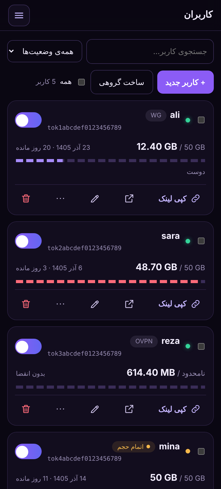
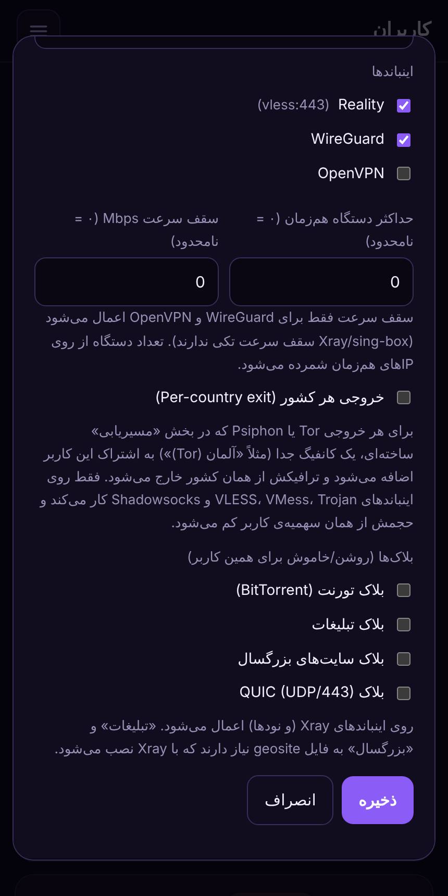
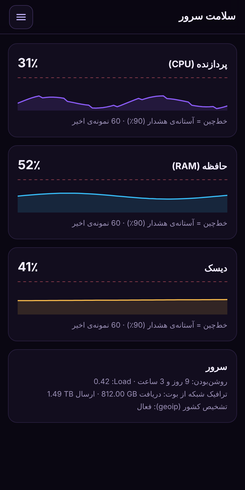
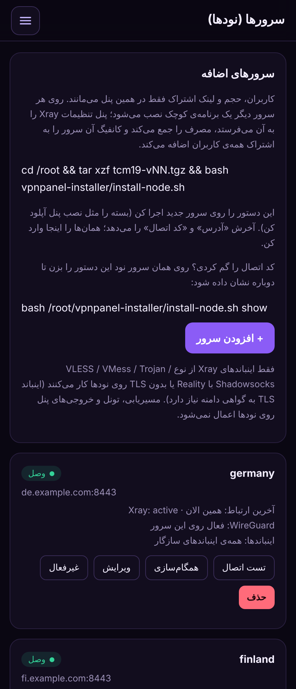
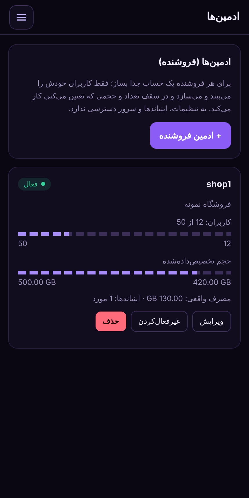

<div align="center">

# TCM19 Panel

**پنل شخصی مدیریت VPN / پروکسی با رابط فارسی راست‌چین**
*A personal VPN / proxy management panel with a Persian RTL interface*

`FastAPI` · `SQLite` · `Xray` · `sing-box` · `Mihomo` · `WireGuard` · `OpenVPN`

</div>

---

## فهرست

- [تصاویر](#تصاویر)
- [نصب](#نصب)
- [به‌روزرسانی و حذف](#بهروزرسانی-و-حذف)
- [امکانات](#امکانات)
- [منوی مدیریت tcm19](#منوی-مدیریت-tcm19)
- [سرور اضافه (Node)](#سرور-اضافه-node)
- [صفحه‌ی اشتراک کاربر](#صفحهی-اشتراک-کاربر)
- [ادمین فروشنده](#ادمین-فروشنده-reseller)
- [ربات تلگرام](#ربات-تلگرام)
- [API](#api)
- [بکاپ و بازیابی](#بکاپ-و-بازیابی)
- [امنیت](#امنیت)
- [پرسش‌های پرتکرار](#پرسشهای-پرتکرار)
- [تاریخچه‌ی نسخه‌ها](#تاریخچهی-نسخهها)
- [English](#english)

---

## تصاویر

<div align="center">

| کاربران | فرم کاربر و بلاک‌ها |
|:---:|:---:|
|  |  |

| سلامت سرور | سرورهای اضافه (Node) |
|:---:|:---:|
|  |  |

| ادمین فروشنده |
|:---:|
|  |

</div>

> تصاویر با داده‌ی نمونه‌ی ساختگی گرفته شده‌اند.

---

## نصب

نیازمندی‌ها:

- سرور Ubuntu یا Debian تازه، دسترسی `root`
- اگر دامنه داری: دامنه باید به IP سرور اشاره کند (برای گرفتن SSL رایگان)
- پورت‌های پنل و اینباندها در فایروال باز باشند

### نصب یک‌خطی

```bash
bash <(curl -Ls https://raw.githubusercontent.com/wxmpire/TCM19-panel/main/install.sh) https://raw.githubusercontent.com/wxmpire/TCM19-panel/main/vpnpanel-installer.tgz
```

نصب‌کننده این‌ها را می‌پرسد (با Enter مقدار تصادفی/پیش‌فرض انتخاب می‌شود):

1. نصب با **IP** یا **دامنه** (با دامنه، گواهی SSL رایگان گرفته می‌شود)
2. نام کاربری و رمز ادمین
3. نصب هر موتور: Xray، sing-box، Mihomo، WireGuard، OpenVPN

بعد از نصب، آدرس و اطلاعات ورود نمایش داده می‌شود. منوی مدیریت را با `tcm19` باز کن.

### نصب بدون پرسش (متغیرهای محیطی)

```bash
PANEL_MODE=domain PANEL_DOMAIN=example.com PANEL_PORT=34567 \
PANEL_USER=admin PANEL_PASS='رمز-قوی' \
INSTALL_XRAY=1 INSTALL_SINGBOX=1 \
bash <(curl -Ls https://raw.githubusercontent.com/wxmpire/TCM19-panel/main/install.sh) https://raw.githubusercontent.com/wxmpire/TCM19-panel/main/vpnpanel-installer.tgz
```

متغیرهای قابل استفاده: `PANEL_MODE` (`ip` یا `domain`)، `PANEL_DOMAIN`، `PANEL_PORT`، `PANEL_USER`، `PANEL_PASS`، `INSTALL_XRAY`، `INSTALL_SINGBOX`، `INSTALL_MIHOMO`، `INSTALL_WIREGUARD`.

### نصب از روی فایل (بدون هاست)

بسته‌ی `tcm19-vNN.tgz` را با SFTP در `/root` بگذار و:

```bash
cd /root && tar xzf tcm19-vNN.tgz && bash vpnpanel-installer/install.sh
```

---

## به‌روزرسانی و حذف

**به‌روزرسانی:** همان دستور نصب را دوباره اجرا کن. روی سرور نصب‌شده فقط کد عوض می‌شود؛ داده‌ها و سرویس‌ها می‌مانند. بعد در مرورگر `Ctrl+F5` بزن.

**از داخل منو:** `tcm19` ← گزینه‌ی ۲ (آپدیت) یا ۳ (آپدیت از فایل/لینک). اگر آپدیت مشکل داشت، گزینه‌ی ۵ برگشت به نسخه‌ی قبل است.

**حذف کامل:** `tcm19` ← گزینه‌ی ۶.

داده‌ها در `/opt/vpnpanel/data/` ذخیره می‌شوند (دیتابیس: `panel.db`).

---

## امکانات

### کاربران و اشتراک

- حجم، تاریخ انقضا، بازنشانی دوره‌ای مصرف
- محدودیت تعداد دستگاه هم‌زمان (از روی IPهای هم‌زمان)
- سقف سرعت برای WireGuard و OpenVPN
- ساخت گروهی کاربر، قطع اتصال کاربر آنلاین، صفحه‌ی «آنلاین‌ها»
- تشخیص اشتراک‌گذاری حساب از روی کشور IP (هشدار، اعلان تلگرام یا غیرفعال‌سازی خودکار)
- لاگ فعالیت و نمودار مصرف (کاربر، سرور، پرمصرف‌ها)

### پروتکل‌ها و موتورها

| موتور | پروتکل‌ها |
|---|---|
| **Xray** | VLESS، VMess، Trojan، Shadowsocks (Reality، TLS، WebSocket، gRPC و …)، SOCKS5/HTTP |
| **sing-box** | همان خانواده‌ی پروتکل‌ها |
| **Mihomo** | Mieru، Sudoku، ShadowQUIC، TrustTunnel |
| **WireGuard** | ساخت خودکار کلید و IP هر کاربر، فایل و QR |
| **OpenVPN** | ساخت خودکار CA و گواهی هر کاربر، فایل `.ovpn` |

از صفحه‌ی **موتورها** می‌شود هر موتور را نصب، به‌روزرسانی، روشن/خاموش، ریستارت یا حذف کرد و لاگ نصب را دید.

### خروجی‌ها (Outbounds) و مسیریابی

- Direct، Block، Cloudflare WARP، Tor، Psiphon (برای هر کشور جدا)
- **NordVPN** (NordLynx) با توکن حساب؛ ساخت چند کشور یک‌جا
- SOCKS5، HTTP، Shadowsocks و WireGuard به‌عنوان upstream
- قوانین مسیریابی بر اساس اینباند، دامنه (`geosite:` و …)، IP (`geoip:`)، پورت، شبکه و پروتکل
- هر ذخیره قبل از اعمال توسط موتور بررسی می‌شود و در صورت خطا برمی‌گردد
- دکمه‌ی تست: درخواست واقعی از خروجی می‌فرستد و IP و کشور خروج را نشان می‌دهد
- **خروجی هر کشور برای کاربر:** برای هر خروجی Tor/Psiphon یک کانفیگ جدا در اشتراک

### بلاک برای هر کاربر یا فروشنده

کلیدهای روشن/خاموش در فرم کاربر و فرم فروشنده:

- بلاک تورنت (BitTorrent)
- بلاک تبلیغات
- بلاک سایت‌های بزرگسال
- بلاک QUIC (UDP/443)

بلاکی که برای فروشنده روشن شود برای همه‌ی کاربرانش اعمال می‌شود. این بلاک‌ها روی اینباندهای Xray (و نودها) کار می‌کنند.

### تونل‌ها

فوروارد ساده، فوروارد از طریق خروجی، تونل معکوس، تونل SSH و فوروارد کرنل (iptables)، هر کدام با راهنمای اتصال و شمارنده‌ی ترافیک.

### سلامت سرور

نمودار CPU / RAM / دیسک، هشدار در لاگ و تلگرام با آستانه‌ی قابل‌تنظیم، و بررسی از کار افتادن پورت اینباندها.

### سرورهای اضافه (Node)

Xray و WireGuard روی سرورهای دیگر، با مدیریت واحد در همین پنل. جزئیات پایین‌تر.

---

## منوی مدیریت tcm19

بعد از نصب، در ترمینال `tcm19` بزن:

| شماره | کار |
|---|---|
| 1 – 6 | نصب مجدد، آپدیت، آپدیت از فایل/لینک، آپدیت منو، برگشت به نسخه‌ی قبل، حذف |
| 7 – 9 | تغییر رمز ادمین، باز کردن قفل ورود، بازنشانی تنظیمات |
| 10 – 11 | تغییر پورت پنل، تنظیمات |
| 12 – 16 | روشن، خاموش، ریستارت پنل، ریستارت موتورها، وضعیت |
| 17 | لاگ‌ها |
| 18 – 19 | روشن/خاموش‌کردن اجرای خودکار با بوت |
| 20 – 22 | SSL، Cloudflare، IPها |
| 23 – 24 | فایروال (ufw)، SSH |
| 25 | مدیریت موتورها (نصب، آپدیت، روشن/خاموش، لاگ، حذف) |
| 26 | BBR |
| 27 | geoip برای تشخیص کشور |
| 28 | اسپید تست |
| 29 | دیتابیس |
| 30 | خروج همه‌ی دستگاه‌ها |
| 31 | ربات تلگرام |

میانبرها: `tcm19 engines` (مدیریت موتورها)، `tcm19 kick` (خروج همه‌ی دستگاه‌ها).

---

## سرور اضافه (Node)

کاربران، حجم و لینک اشتراک فقط در پنل اصلی می‌مانند. روی سرور دوم یک برنامه‌ی کوچک (agent) نصب می‌شود؛ پنل کانفیگ را به آن می‌فرستد، مصرف را جمع می‌کند و کانفیگ آن سرور را به اشتراک همه‌ی کاربران اضافه می‌کند.

**روی سرور دوم:**

```bash
cd /root && tar xzf tcm19-vNN.tgz && bash vpnpanel-installer/install-node.sh
```

آدرس و «کد اتصال» را می‌دهد؛ در پنل اصلی ← **سرورها** ← افزودن سرور وارد کن.

کد اتصال را گم کردی؟ روی همان سرور نود:

```bash
bash /root/vpnpanel-installer/install-node.sh show
```

حذف برنامه‌ی نود: `bash /root/vpnpanel-installer/install-node.sh uninstall`

**چطور کار می‌کند:**

- ارتباط پنل و نود با HTTPS و گواهی خودامضا انجام می‌شود که با اثرانگشت SHA-256 داخل کد اتصال پین شده است
- هر درخواست با HMAC امضا می‌شود (با محدودیت اختلاف ساعت و جلوگیری از تکرار)
- اینباندهای VLESS / VMess / Trojan / Shadowsocks با Reality یا بدون TLS روی نودها کار می‌کنند
- **WireGuard روی نود:** با تیک «WireGuard هم روی این سرور فعال شود»؛ کلیدها و IPها همان پنل‌اند و برای هر نود یک فایل WG جدا در اشتراک کاربر می‌آید

**محدودیت‌های نود:**

- مسیریابی، تونل و خروجی‌های پنل روی نودها اعمال نمی‌شود
- کاربران آنلاین، محدودیت دستگاه/کشور و سقف سرعت برای نودها کار نمی‌کند
- OpenVPN روی نود هنوز پشتیبانی نمی‌شود

---

## صفحه‌ی اشتراک کاربر

باز کردن لینک اشتراک در مرورگر یک صفحه‌ی شخصی نشان می‌دهد (اپ‌های VPN همان لینک را به‌صورت اشتراک معمولی می‌گیرند):

- وضعیت، حلقه‌ی حجم و زمان، نمودار مصرف ۱۴ روز
- کپی و QR برای لینک و تک‌تک کانفیگ‌ها
- دکمه‌ی «افزودن به برنامه» برای iOS، اندروید، ویندوز و مک
- کانفیگ Clash و WireGuard (برای هر نود جدا) و فایل OpenVPN
- سه زبان: فارسی، English، Русский
- رنگ دلخواه، لوگو و پیام اطلاع‌رسانی از تنظیمات

اجبار نمایش: `?page=1` (صفحه) یا `?raw=1` (فرمت اپ). صفحه `noindex` است، ولی هر کسی که لینک را دارد می‌تواند آن را ببیند؛ لینک را به اشتراک نگذار.

---

## ادمین فروشنده (Reseller)

ادمین‌های جدا با سهمیه (تنظیمات ← ادمین‌ها):

- سقف تعداد کاربر و سقف مجموع حجم
- اینباندهای مجاز
- بلاک‌های اجباری برای همه‌ی کاربرانش
- فقط کاربران خودش را می‌بیند؛ صفحه‌ی «حساب من» برای دیدن مصرف سهمیه

---

## ربات تلگرام

از تنظیمات ← ربات تلگرام یا منوی `tcm19` گزینه‌ی ۳۱:

1. در تلگرام با @BotFather یک ربات بساز و توکن را در پنل وارد کن
2. دستور `/start کد` را که پنل می‌دهد (۲۴ ساعت اعتبار) برای ربات بفرست

قابلیت‌ها: مدیریت کاربر و کانفیگ، وضعیت و موتورها، تونل‌ها، بکاپ خودکار، اسپید تست، پینگ Check-Host، آپدیت با ارسال فایل، هشدار (محدودیت IP/کشور، سلامت سرور) و مینی‌اپ.

---

## API

از تنظیمات ← API می‌توان کلید ساخت (پیشوند `tcm_`):

- **فقط‌خواندنی** یا **کامل**
- برای ربات‌ها و اسکریپت‌ها؛ مسیرهای حساس (مثل مدیریت ادمین و کلیدها) با کلید API در دسترس نیستند
- نمونه‌کد با دکمه‌ی کپی در همان صفحه

---

## بکاپ و بازیابی

تنظیمات ← بکاپ:

- بکاپ کامل `.tgz` (دیتابیس، داده، گواهی‌ها، OpenVPN)
- بکاپ خودکار روزانه
- بازیابی از فایل یا از سرور

---

## امنیت

- توکن ورود JWT با اعتبار ۳۰ روز؛ تغییر رمز یا «خروج همه‌ی دستگاه‌ها» همه‌ی نشست‌ها را باطل می‌کند
- محدودیت تلاش ورود بر اساس IP و نام کاربری
- حداقل ۸ کاراکتر برای رمز
- هدرهای امنیتی، `noindex` برای صفحه‌ی اشتراک
- کلید API با سطح دسترسی و مسیرهای بلاک‌شده
- پنل فروشنده فقط به مسیرهای مجاز دسترسی دارد

اگر حفره‌ی امنیتی پیدا کردی، لطفاً قبل از انتشار عمومی خصوصی گزارش بده (Issue خصوصی یا پیام مستقیم).

---

## پرسش‌های پرتکرار

**بعد از آپدیت پنل همان صفحه‌ی قدیمی را نشان می‌دهد.**
در مرورگر `Ctrl+F5` بزن (روی گوشی: پاک‌کردن کش).

**رمز ادمین را فراموش کردم.**
`tcm19` ← گزینه‌ی ۷.

**بعد از چند بار رمز اشتباه وارد نمی‌شود.**
`tcm19` ← گزینه‌ی ۸ (باز کردن قفل).

**کد اتصال نود را گم کردم.**
روی سرور نود: `bash /root/vpnpanel-installer/install-node.sh show`

**تبلیغات یا بزرگسال بلاک نمی‌شود.**
این دو به فایل geosite کنار Xray نیاز دارند که با Xray نصب می‌شود؛ مطمئن شو Xray کامل نصب شده و بعد از تغییر، تنظیمات اعمال شده است.

**کشور کاربران نمایش داده نمی‌شود.**
فایل `geoip.dat` پیدا نشده؛ `tcm19` ← گزینه‌ی ۲۷.

**آپدیت خراب شد.**
`tcm19` ← گزینه‌ی ۵ (برگشت به نسخه‌ی قبل).

---

## تاریخچه‌ی نسخه‌ها

| نسخه | تغییرات مهم |
|---|---|
| v46 | اصلاح متن راهنمای صفحه‌ی سرورها |
| v45 | WireGuard روی نودها |
| v44 | بلاک تورنت / تبلیغات / بزرگسال / QUIC برای هر کاربر و فروشنده |
| v43 | راهنمای گرفتن توکن NordVPN داخل پنل |
| v42 | NordVPN: ساخت چند کشور یک‌جا |
| v41 | NordVPN به‌عنوان خروجی (NordLynx) |
| v40 | WireGuard و OpenVPN در صفحه‌ی موتورها |
| v38–39 | پنل چندسروره (نودها) و بازیابی کد اتصال |
| v37 | سلامت سرور و تشخیص اشتراک‌گذاری حساب با کشور |
| v35 | ادمین فروشنده، «حساب من»، بهبود صفحه‌ی اشتراک |
| v34 | لاگ فعالیت، آنلاین‌ها، نمودار مصرف، محدودیت دستگاه و سرعت |
| v33 | ربات تلگرام |
| v32 | بکاپ و بازیابی |
| v27–29 | موتور OpenVPN و مدیریت موتورها در منو |
| v21–24 | تونل‌ها |
| v15–19 | موتور Mihomo و صفحه‌ی اشتراک |

---

## هشدار

این پروژه یک ابزار شخصی است و بدون هیچ ضمانتی ارائه می‌شود. مسئولیت نحوه‌ی استفاده و رعایت قوانین کشور و ارائه‌دهنده‌ی سرور با خود کاربر است.

---

## English

**TCM19 Panel** is a personal VPN / proxy management panel (FastAPI + SQLite, single-file Persian RTL UI) with Xray, sing-box, Mihomo, WireGuard and OpenVPN engines.

**Install** (root, fresh Ubuntu/Debian):

```bash
bash <(curl -Ls https://raw.githubusercontent.com/wxmpire/TCM19-panel/main/install.sh) https://raw.githubusercontent.com/wxmpire/TCM19-panel/main/vpnpanel-installer.tgz
```

**Update:** run the same command again (code only; data is kept). **Menu:** `tcm19`.

**Highlights:** users with quotas, expiry and device limits; per-user blocks (torrent / ads / adult / QUIC); reseller admins; Xray + WireGuard on extra nodes; outbounds (WARP, Tor, Psiphon, NordVPN, SOCKS/HTTP/SS/WG); routing rules; tunnels; server health with alerts; Telegram bot; API keys; backups; personal subscription page (fa / en / ru).

**Disclaimer:** personal tool, provided as is, without warranty. You are responsible for how you use it and for complying with local laws and your hosting provider's terms.
