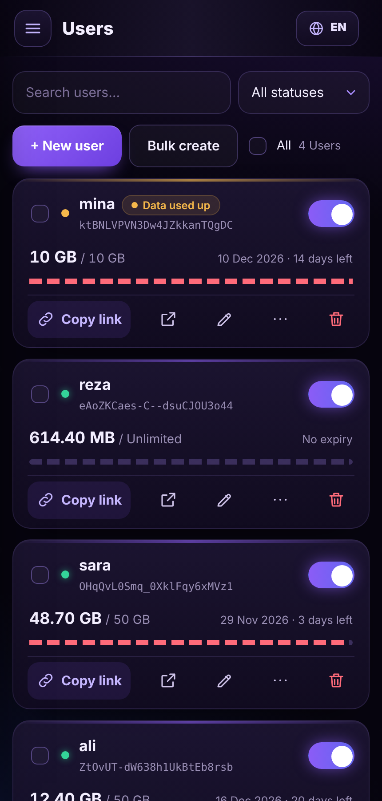
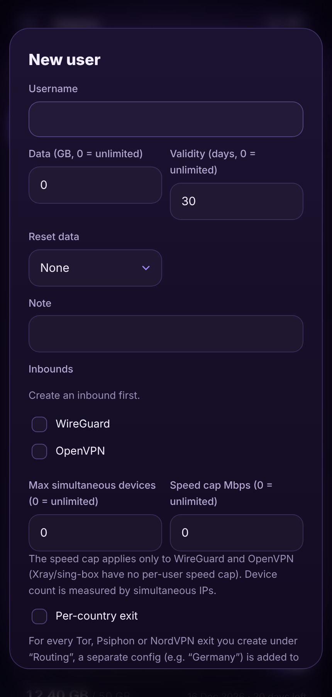
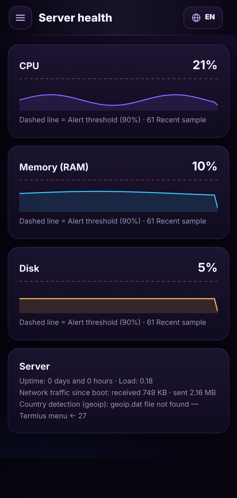
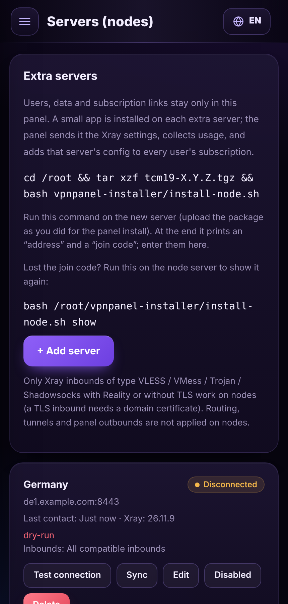
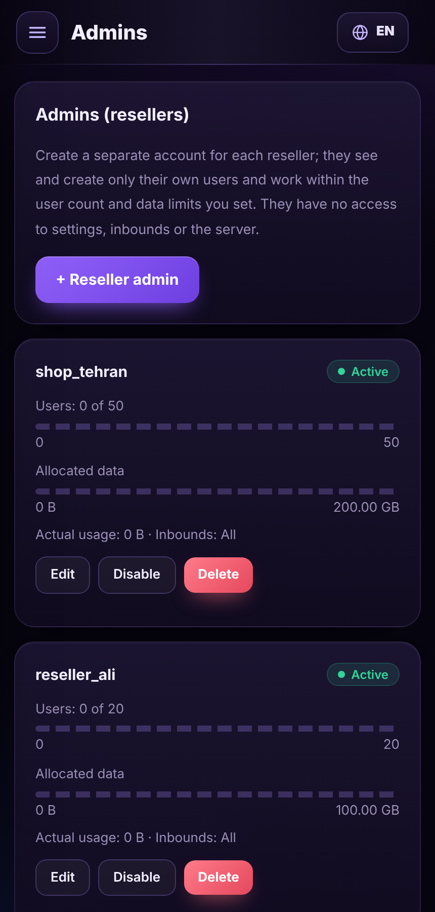

# TCM19 Panel

A personal VPN / proxy management panel (FastAPI + SQLite, single-file UI in Persian (RTL), English and Russian) with Xray, sing-box, Mihomo, WireGuard and OpenVPN engines.

**[راهنمای فارسی](README.fa.md)**

<div align="center">

| Users | User form and blocks |
|:---:|:---:|
|  |  |

| Server health | Extra servers (nodes) |
|:---:|:---:|
|  |  |

| Reseller admins |
|:---:|
|  |

</div>

> Screenshots use made-up sample data. The panel speaks Persian, English and Russian (language button in the top bar); these screenshots are the English interface, see [README.fa.md](README.fa.md) for the Persian ones.

## Install

On a fresh Ubuntu/Debian server, as root:

```bash
bash <(curl -Ls https://raw.githubusercontent.com/wxmpire/TCM19-panel/main/install.sh) https://raw.githubusercontent.com/wxmpire/TCM19-panel/main/vpnpanel-installer.tgz
```

The installer asks for an IP or domain (a domain gets a free SSL certificate), the admin username and password (Enter = random), and which engines to install. Afterwards, run `tcm19` for the management menu.

Unattended install (environment variables): `PANEL_MODE` (`ip` or `domain`), `PANEL_DOMAIN`, `PANEL_PORT`, `PANEL_USER`, `PANEL_PASS`, `INSTALL_XRAY`, `INSTALL_SINGBOX`, `INSTALL_MIHOMO`, `INSTALL_WIREGUARD`.

From a package file: upload `tcm19-X.Y.Z.tgz` to `/root`, then:

```bash
cd /root && tar xzf tcm19-X.Y.Z.tgz && bash vpnpanel-installer/install.sh
```

## Update and remove

- **Update:** run the same install command again. Only the code changes; data and services are kept. Then hard-refresh the browser (Ctrl+F5).
- **From the menu:** `tcm19` → 2 (update), 3 (update from file/URL), 5 (roll back), 6 (uninstall).
- Data lives in `/opt/vpnpanel/data/` (database: `panel.db`).

## Features

- **Users and subscriptions:** quota, expiry, periodic reset, device limit, speed limit (WireGuard/OpenVPN), bulk creation, online users with kick, account-sharing detection by IP country, activity log and usage charts
- **Engines and protocols:** VLESS, VMess, Trojan, Shadowsocks (Xray / sing-box); Mieru, Sudoku, ShadowQUIC, TrustTunnel (Mihomo); WireGuard; OpenVPN. Install, update, start/stop and remove engines from the Engines page
- **Outbounds and routing:** Direct, Block, Cloudflare WARP, Tor, Psiphon (per country), NordVPN (NordLynx, several countries at once, also as per-country exits), SOCKS5/HTTP/Shadowsocks/WireGuard upstreams; routing rules validated before applying; per-country exits for users
- **Per-user blocks:** torrent, ads, adult sites, QUIC (on/off per user, or for all users of a reseller; Xray inbounds and nodes)
- **Reseller admins:** separate admins with user/traffic quotas and allowed inbounds
- **Nodes:** Xray and WireGuard on extra servers, managed from one panel
- **Tunnels:** simple forward, forward via outbound, reverse tunnel, SSH tunnel, kernel forward
- **Server health:** CPU / RAM / disk charts with alerts, inbound port checks
- **Telegram bot, API keys, backups** (manual and daily automatic)
- **Subscription page:** personal page per user with QR codes, app buttons (iOS, Android, Windows, Mac), 14-day usage chart; Persian / English / Russian

## Nodes

On the second server:

```bash
cd /root && tar xzf tcm19-X.Y.Z.tgz && bash vpnpanel-installer/install-node.sh
```

It prints an address and a connection code; enter them in the panel under Servers. To show the code again: `bash /root/vpnpanel-installer/install-node.sh show`. To remove the node agent: `... install-node.sh uninstall`.

The panel talks to the agent over HTTPS with a self-signed certificate pinned by its SHA-256 fingerprint (inside the connection code), and every request is HMAC-signed with timestamp and replay protection.

Limits: routing, tunnels and panel outbounds are not applied on nodes; online users, device/country limits and speed limits do not cover nodes; OpenVPN on nodes is not supported yet.

## Menu: `tcm19`

| No. | Action |
|---|---|
| 1-6 | Reinstall, update, update from file/URL, update menu, roll back, uninstall |
| 7-9 | Change admin password, unlock login, reset settings |
| 10-11 | Change panel port, settings |
| 12-16 | Start, stop, restart panel, restart engines, status |
| 17 | Logs |
| 18-19 | Autostart on/off |
| 20-22 | SSL, Cloudflare, IPs |
| 23-24 | Firewall (ufw), SSH |
| 25 | Engines manager |
| 26-28 | BBR, geoip, speed test |
| 29 | Database |
| 30 | Log out all devices |
| 31 | Telegram bot |

Shortcuts: `tcm19 engines`, `tcm19 kick`.

## Security

JWT login (30 days, revoked on password change or "log out all devices"), login rate limiting per IP and username, minimum 8-character passwords, security headers, API keys with read/full scope and blocked sensitive paths, resellers limited to an allow-list of endpoints.

## Disclaimer

A personal tool, provided as is, without warranty. You are responsible for how you use it and for complying with local laws and your hosting provider's terms.
